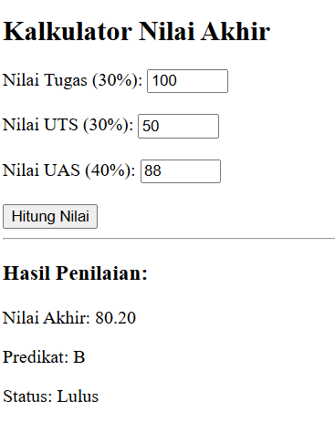
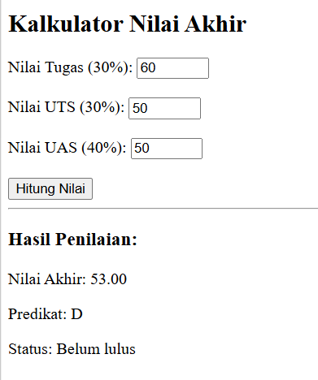
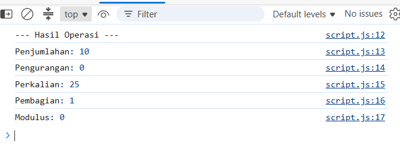
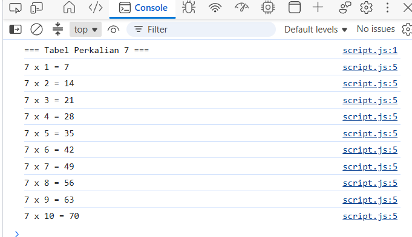
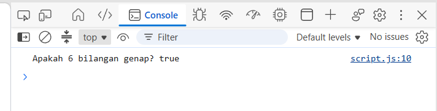
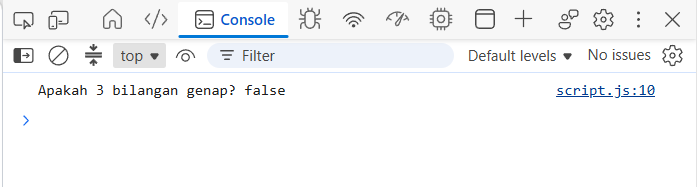
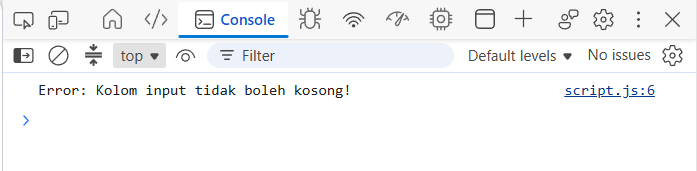
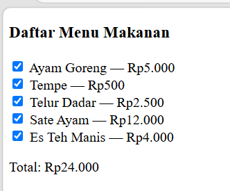
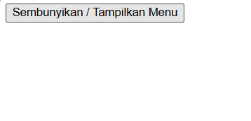

# Praktikum 5: Java Script Dasar

Repository ini disusun untuk memenuhi tugas **Praktikum 5 - Java Script Dasar** pada mata kuliah Pemrograman Web.

**Identitas Mahasiswa:**
- **Nama:** Gama Daya Laksana
- **NIM:** 312510051
- **Kelas:** I253A
- **Program Studi:** Teknik Informatika
- **Dosen Pengampu:** Agung Nugroho, S.Kom., M.Kom.
- **Kampus:** Universitas Pelita Bangsa

---


# Langkah-Langkah Praktikum

## 1. Menampilkan output
**Tujuan: mengenali cara menampilkan output di halaman dan Console.**

### Kode JS

```JS
// script.js
document.getElementById("pesan").textContent = "Hello World";
console.log("Hello World");
```
• Jalankan halaman di browser.
• Pastikan teks pada halaman berubah.
• Pastikan pesan Hello World tampil di Console.
• Catat perbedaan output pada halaman dan Console.

**Screenshot Hasil:**


## 2. Alert dan prompt

### Kode CSS

```css
const namaPengguna = prompt("Masukkan nama Anda:", "");
if (namaPengguna && namaPengguna.trim() !== "") {
alert("Halo, " + namaPengguna + "!");
document.getElementById("pesan").textContent = "Selamat datang, " + namaPengguna + ".";
} else {
alert("Nama belum diisi.");
}
```
**Uji dengan memasukkan nama, menekan Cancel, dan membiarkan input kosong. Catat perilaku
program.**

**Screenshot Hasil:**


## 3. Function dan operasi aritmetika

**Buat function yang menerima dua bilangan, lalu menampilkan hasil penjumlahan, pengurangan,
perkalian, pembagian, dan sisa bagi.**

### Kode JS

```JS
function operasiDasar(a, b) {
console.log("Penjumlahan:", a + b);
console.log("Pengurangan:", a - b);
console.log("Perkalian:", a * b);
console.log("Pembagian:", b !== 0 ? a / b : "Tidak dapat dibagi nol");
console.log("Modulus:", a % b);
}
operasiDasar(9, 4);
```

**Screenshot Hasil:**


## 4. Seleksi kondisi if–else

**Buat program yang meminta nilai melalui prompt. Nilai minimal 60 dinyatakan lulus. Perhatikan
bahwa prompt menghasilkan string sehingga masukan numerik perlu dikonversi.**

### Kode JS

```JS
const inputNilai = prompt("Masukkan nilai (0–100):");
const nilaiMahasiswa = Number(inputNilai);
if (inputNilai === null || inputNilai.trim() === "" ||
Number.isNaN(nilaiMahasiswa) || nilaiMahasiswa < 0 || nilaiMahasiswa > 100) {
alert("Input nilai tidak valid.");
} else if (nilaiMahasiswa >= 60) {
alert("Lulus");
} else {
alert("Belum lulus");
}
```

**Screenshot Hasil:**


## 5. Seleksi kondisi switch
**Minta pengguna memasukkan angka 1–5 dan tampilkan nama bilangan menggunakan switch.**

### JS

```JS
const inputPilihan = prompt("Masukkan angka 1–5:");
switch (inputPilihan) {
case "1": alert("Bilangan satu"); break;
case "2": alert("Bilangan dua"); break;
case "3": alert("Bilangan tiga"); break;
case "4": alert("Bilangan empat"); break;
case "5": alert("Bilangan lima"); break;
default: alert("Pilihan tidak tersedia");
}
```

**Screenshot Hasil:**


## 6.Form bilangan genap atau ganjil
**Tambahkan form berikut pada body index.html. Saat tombol ditekan, program memeriksa
bilangan dan menampilkan apakah bilangan genap atau ganjil.**

### Kode HTML
```HTML
<label for="bilangan">Masukkan bilangan bulat:</label>
<input type="number" id="bilangan" step="1">
<button type="button" onclick="cekBilangan()">Periksa</button>
<p id="hasilBilangan"></p>

```

### Kode JS

```JS
function cekBilangan() {
const input = document.getElementById("bilangan").value;
const angka = Number(input);
const hasil = document.getElementById("hasilBilangan");
if (input.trim() === "" || !Number.isInteger(angka)) {
hasil.textContent = "Masukkan bilangan bulat yang valid.";
} else if (angka % 2 === 0) {
hasil.textContent = "Bilangan genap";
} else {
hasil.textContent = "Bilangan ganjil";
}
}
```
**Uji dengan angka positif, angka negatif, nol, bilangan desimal, dan input kosong.**

**Screenshot Hasil:**


## 7. Mengubah Warna Halaman
**Buat tiga tombol yang mengubah warna latar halaman. Gunakan satu function dengan
parameter agar kode tidak berulang.**

```JS
function ubahWarnaLatar(warna) {
document.body.style.backgroundColor = warna;
}
<button type="button" onclick="ubahWarnaLatar('lightgreen')">Latar Hijau</button>
<button type="button" onclick="ubahWarnaLatar('white')">Latar Putih</button>
<button type="button" onclick="ubahWarnaLatar('lightyellow')">Latar Kuning</button>
```


## 8. DOM dan checkbox menu makanan
**Buat daftar menu menggunakan checkbox. Total harga berubah otomatis ketika pilihan
dicentang atau dilepas.**

```JS
const daftarMenu = document.querySelectorAll(".menu");
daftarMenu.forEach((item) => {
item.addEventListener("change", hitungTotal);
});
function hitungTotal() {
let total = 0;
daftarMenu.forEach((item) => {
if (item.checked) total += Number(item.value);
});
document.getElementById("total").textContent = total.toLocaleString("id-ID");
}
```

```HTML
<h3>Daftar Menu Makanan</h3>
<label><input type="checkbox" class="menu" value="5000"> Ayam Goreng — Rp5.000</label><br>
<label><input type="checkbox" class="menu" value="500"> Tempe — Rp500</label><br>
<label><input type="checkbox" class="menu" value="2500"> Telur Dadar — Rp2.500</label><br>
<p>Total: Rp<span id="total">0</span></p>
```

**Catatan: contoh ini menggunakan event listener dan manipulasi DOM. Pastikan elemen HTML
telah tersedia sebelum script dijalankan; meletakkan `<script src="script.js"></script>` menjelang
akhir body merupakan pilihan sederhana.**


## F. Mini Project — Kalkulator Nilai Mahasiswa
**Kembangkan program yang menerima nilai tugas, UTS, dan UAS, menghitung nilai akhir,
menentukan predikat, serta menampilkan status kelulusan.**

```JS
function hitungNilaiAkhir(tugas, uts, uas) {
return tugas * 0.30 + uts * 0.30 + uas * 0.40;
}
function tentukanPredikat(nilai) {
if (nilai >= 85) return "A";
if (nilai >= 75) return "B";
if (nilai >= 60) return "C";
if (nilai >= 50) return "D";
return "E";
}
const tugas = 85;
const uts = 78;
const uas = 88;
const akhir = hitungNilaiAkhir(tugas, uts, uas);
console.log("Nilai akhir:", akhir.toFixed(2));
console.log("Predikat:", tentukanPredikat(akhir));
console.log("Status:", akhir >= 60 ? "Lulus" : "Belum lulus");
```


**• Tambahkan form input untuk ketiga komponen nilai.**

```HTML
<!DOCTYPE html>
<html lang="id">
<head>
    <meta charset="UTF-8">
    <title>Hitung Nilai Akhir</title>
</head>
<body>

    <h2>Kalkulator Nilai Akhir</h2>

    <form id="formNilai">
        <div>
            <label for="tugas">Nilai Tugas (30%):</label>
            <input type="number" id="tugas" min="0" max="100" value="85" required>
        </div>
        <br>
        <div>
            <label for="uts">Nilai UTS (30%):</label>
            <input type="number" id="uts" min="0" max="100" value="78" required>
        </div>
        <br>
        <div>
            <label for="uas">Nilai UAS (40%):</label>
            <input type="number" id="uas" min="0" max="100" value="88" required>
        </div>
        <br>
        <button type="button" onclick="prosesHitung()">Hitung Nilai</button>
    </form>

    <hr>

    <div id="hasil">
        <p>Nilai akhir: <span id="outNilaiAkhir">-</span></p>
        <p>Predikat: <span id="outPredikat">-</span></p>
        <p>Status: <span id="outStatus">-</span></p>
    </div>

    <script src="script.js"></script>
</body>
</html>
```

```JS
function hitungNilaiAkhir(tugas, uts, uas) {
    return tugas * 0.30 + uts * 0.30 + uas * 0.40;
}

function tentukanPredikat(nilai) {
    if (nilai >= 85) return "A";
    if (nilai >= 75) return "B";
    if (nilai >= 60) return "C";
    if (nilai >= 50) return "D";
    return "E";
}

function prosesHitung() {
    const tugas = parseFloat(document.getElementById("tugas").value) || 0;
    const uts = parseFloat(document.getElementById("uts").value) || 0;
    const uas = parseFloat(document.getElementById("uas").value) || 0;

    const akhir = hitungNilaiAkhir(tugas, uts, uas);
    const predikat = tentukanPredikat(akhir);
    const status = akhir >= 60 ? "Lulus" : "Belum lulus";

    document.getElementById("outNilaiAkhir").innerText = akhir.toFixed(2);
    document.getElementById("outPredikat").innerText = predikat;
    document.getElementById("outStatus").innerText = status;

    console.log("Nilai akhir:", akhir.toFixed(2));
    console.log("Predikat:", predikat);
    console.log("Status:", status);
}
```


**• Validasi agar setiap nilai berada pada rentang 0–100.**
```JS
function hitungNilaiAkhir(tugas, uts, uas) {
    return tugas * 0.30 + uts * 0.30 + uas * 0.40;
}

function tentukanPredikat(nilai) {
    if (nilai >= 85) return "A";
    if (nilai >= 75) return "B";
    if (nilai >= 60) return "C";
    if (nilai >= 50) return "D";
    return "E";
}

function prosesHitung() {
    // Ambil nilai dari input
    const tugasInput = document.getElementById("tugas").value;
    const utsInput = document.getElementById("uts").value;
    const uasInput = document.getElementById("uas").value;

    // Cek apakah ada input yang kosong
    if (tugasInput === "" || utsInput === "" || uasInput === "") {
        alert("Semua kolom nilai harus diisi!");
        return;
    }

    const tugas = parseFloat(tugasInput);
    const uts = parseFloat(utsInput);
    const uas = parseFloat(uasInput);

    // Validasi rentang nilai 0 - 100
    if (tugas < 0 || tugas > 100 || uts < 0 || uts > 100 || uas < 0 || uas > 100) {
        alert("Setiap nilai harus berada pada rentang 0 sampai 100!");
        return;
    }

    // Jika validasi lolos, lanjutkan perhitungan
    const akhir = hitungNilaiAkhir(tugas, uts, uas);
    const predikat = tentukanPredikat(akhir);
    const status = akhir >= 60 ? "Lulus" : "Belum lulus";

    // Tampilkan hasil
    document.getElementById("outNilaiAkhir").innerText = akhir.toFixed(2);
    document.getElementById("outPredikat").innerText = predikat;
    document.getElementById("outStatus").innerText = status;

    console.log("Nilai akhir:", akhir.toFixed(2));
    console.log("Predikat:", predikat);
    console.log("Status:", status);
}
```


**• Tampilkan nilai akhir, predikat, dan status pada halaman HTML, bukan hanya Console.**
```JS
function hitungNilaiAkhir(tugas, uts, uas) {
    return tugas * 0.30 + uts * 0.30 + uas * 0.40;
}

function tentukanPredikat(nilai) {
    if (nilai >= 85) return "A";
    if (nilai >= 75) return "B";
    if (nilai >= 60) return "C";
    if (nilai >= 50) return "D";
    return "E";
}

function prosesHitung() {
    const tugasInput = document.getElementById("tugas").value;
    const utsInput = document.getElementById("uts").value;
    const uasInput = document.getElementById("uas").value;

    // Validasi input kosong
    if (tugasInput === "" || utsInput === "" || uasInput === "") {
        alert("Semua kolom nilai harus diisi!");
        return;
    }

    const tugas = parseFloat(tugasInput);
    const uts = parseFloat(utsInput);
    const uas = parseFloat(uasInput);

    // Validasi rentang nilai 0 - 100
    if (tugas < 0 || tugas > 100 || uts < 0 || uts > 100 || uas < 0 || uas > 100) {
        alert("Setiap nilai harus berada pada rentang 0 sampai 100!");
        return;
    }

    // Proses perhitungan
    const akhir = hitungNilaiAkhir(tugas, uts, uas);
    const predikat = tentukanPredikat(akhir);
    const status = akhir >= 60 ? "Lulus" : "Belum lulus";

    // MENAMPILKAN HASIL KE HALAMAN HTML
    document.getElementById("outNilaiAkhir").innerText = akhir.toFixed(2);
    document.getElementById("outPredikat").innerText = predikat;
    document.getElementById("outStatus").innerText = status;
}
```


**• Gunakan function untuk memisahkan proses perhitungan dari tampilan hasil.**
```JS
function hitungNilaiAkhir(tugas, uts, uas) {
    return tugas * 0.30 + uts * 0.30 + uas * 0.40;
}

function tentukanPredikat(nilai) {
    if (nilai >= 85) return "A";
    if (nilai >= 75) return "B";
    if (nilai >= 60) return "C";
    if (nilai >= 50) return "D";
    return "E";
}

function prosesHitung() {
    const tugasInput = document.getElementById("tugas").value;
    const utsInput = document.getElementById("uts").value;
    const uasInput = document.getElementById("uas").value;

    // Validasi input kosong
    if (tugasInput === "" || utsInput === "" || uasInput === "") {
        alert("Semua kolom nilai harus diisi!");
        return;
    }

    const tugas = parseFloat(tugasInput);
    const uts = parseFloat(utsInput);
    const uas = parseFloat(uasInput);

    // Validasi rentang nilai 0 - 100
    if (tugas < 0 || tugas > 100 || uts < 0 || uts > 100 || uas < 0 || uas > 100) {
        alert("Setiap nilai harus berada pada rentang 0 sampai 100!");
        return;
    }

    // Proses perhitungan
    const akhir = hitungNilaiAkhir(tugas, uts, uas);
    const predikat = tentukanPredikat(akhir);
    const status = akhir >= 60 ? "Lulus" : "Belum lulus";

    // MENAMPILKAN HASIL KE HALAMAN HTML
    document.getElementById("outNilaiAkhir").innerText = akhir.toFixed(2);
    document.getElementById("outPredikat").innerText = predikat;
    document.getElementById("outStatus").innerText = status;
}
```


**Uji sekurang-kurangnya tiga skenario nilai berbeda.**


## G. Eksperimen Mandiri

**1. Ubah Latihan 3 agar menerima dua nilai dari prompt dan mengonversinya menjadi number.**
```JS
function operasiDasar() {
    // Mengambil nilai dari prompt (hasilnya string) dan mengonversinya ke number
    let a = Number(prompt("Masukkan nilai pertama (a):"));
    let b = Number(prompt("Masukkan nilai kedua (b):"));

    // Validasi apakah input valid berupa angka
    if (isNaN(a) || isNaN(b)) {
        console.log("Error: Harap masukkan angka yang valid!");
        return;
    }

    console.log("--- Hasil Operasi ---");
    console.log("Penjumlahan:", a + b);
    console.log("Pengurangan:", a - b);
    console.log("Perkalian:", a * b);
    console.log("Pembagian:", b !== 0 ? a / b : "Tidak dapat dibagi nol");
    console.log("Modulus:", a % b);
}

// Menjalankan fungsi
operasiDasar();
```


**7. Buat perulangan untuk menampilkan tabel perkalian angka 7 dari 1 sampai 10.**
```JS
console.log("=== Tabel Perkalian 7 ===");

for (let i = 1; i <= 10; i++) {
    let hasil = 7 * i;
    console.log(`7 x ${i} = ${hasil}`);
}
```


**8. Buat function cekGenap(angka) yang mengembalikan true jika angka genap.**
```JS
function cekGenapInteraktif() {
    let angka = Number(prompt("Masukkan angka yang ingin dicek:"));

    if (isNaN(angka)) {
        console.log("Error: Harap masukkan angka yang valid!");
        return;
    }

    let hasil = angka % 2 === 0;
    console.log(`Apakah ${angka} bilangan genap? ${hasil}`);
}

// Menjalankan fungsi
cekGenapInteraktif();
```




**9. Tambahkan validasi form agar kolom tidak boleh kosong.**
```JS
function cekGenapInteraktif() {
    let inputUser = prompt("Masukkan angka yang ingin dicek:");

    // 1. Validasi jika pengguna menekan tombol "Cancel" atau membiarkannya kosong
    if (inputUser === null || inputUser.trim() === "") {
        console.log("Error: Kolom input tidak boleh kosong!");
        return;
    }

    // 2. Mengonversi string ke number
    let angka = Number(inputUser);

    // 3. Validasi apakah input valid berupa angka
    if (isNaN(angka)) {
        console.log("Error: Harap masukkan angka yang valid, bukan teks!");
        return;
    }

    // Proses pengecekan genap
    let hasil = angka % 2 === 0;
    console.log(`Apakah ${angka} bilangan genap? ${hasil}`);
}

// Menjalankan fungsi
cekGenapInteraktif();
```


**10. Ubah Latihan 8 dengan menambah minimal dua pilihan menu dan harga.**
```JS
const daftarMenu = document.querySelectorAll(".menu");

daftarMenu.forEach((item) => {
    item.addEventListener("change", hitungTotal);
});

function hitungTotal() {
    let total = 0;
    daftarMenu.forEach((item) => {
        if (item.checked) total += Number(item.value);
    });
    document.getElementById("total").textContent = total.toLocaleString("id-ID");
}
```

```HTML
<!DOCTYPE html>
<html lang="id">
<head>
    <meta charset="UTF-8">
    <title>Daftar Menu Makanan</title>
</head>
<body>

    <h3>Daftar Menu Makanan</h3>
    <label><input type="checkbox" class="menu" value="5000"> Ayam Goreng — Rp5.000</label><br>
    <label><input type="checkbox" class="menu" value="500"> Tempe — Rp500</label><br>
    <label><input type="checkbox" class="menu" value="2500"> Telur Dadar — Rp2.500</label><br>
    <label><input type="checkbox" class="menu" value="12000"> Sate Ayam — Rp12.000</label><br>
    <label><input type="checkbox" class="menu" value="4000"> Es Teh Manis — Rp4.000</label><br>

    <p>Total: Rp<span id="total">0</span></p>

    <!-- Menghubungkan file JavaScript eksternal -->
    <script src="script.js"></script>
</body>
</html>
```


**11. Gunakan tombol untuk menyembunyikan atau menampilkan elemen HTML.**
```HTML
<!DOCTYPE html>
<html lang="id">
<head>
    <meta charset="UTF-8">
    <title>Sembunyikan & Tampilkan Elemen</title>
</head>
<body>

    <!-- Tombol untuk memicu fungsi -->
    <button onclick="toggleElemen()">Sembunyikan / Tampilkan Menu</button>

    <!-- Elemen yang akan disembunyikan atau ditampilkan -->
    <div id="kotakMenu" style="margin-top: 15px;">
        <h3>Daftar Menu Pilihan</h3>
        <label><input type="checkbox" class="menu" value="5000"> Ayam Goreng — Rp5.000</label><br>
        <label><input type="checkbox" class="menu" value="500"> Tempe — Rp500</label><br>
        <label><input type="checkbox" class="menu" value="2500"> Telur Dadar — Rp2.500</label><br>
    </div>

    <!-- Menghubungkan file JavaScript eksternal -->
    <script src="script.js"></script>
</body>
</html>
```

```JS
function toggleElemen() {
    let elemen = document.getElementById("kotakMenu");

    // Mengecek status tampilan elemen saat ini
    if (elemen.style.display === "none") {
        elemen.style.display = "block"; // Menampilkan kembali elemen
    } else {
        elemen.style.display = "none";  // Menyembunyikan elemen
    }
}
```


# Jawaban & Penjelasan Dasar-Dasar JavaScript

## 1. Perbedaan `console.log()`, `alert()`, `prompt()`, dan `textContent` / `innerHTML`

Berikut adalah perbedaan utama berdasarkan fungsi dan cara penampilannya:

* **`console.log()`**
  * **Fungsi:** Menampilkan output di *Console Browser* (Developer Tools).
  * **Tujuan:** Digunakan oleh developer untuk proses *debugging*, mengecek nilai variabel, atau memantau alur program. Tidak terlihat langsung oleh pengguna biasa di halaman web.
  * **Contoh:** `console.log("Pesan ini hanya terlihat di console");`

* **`alert()`**
  * **Fungsi:** Menampilkan pesan peringatan berupa dialog pop-up interaktif di layar browser dengan satu tombol ("OK").
  * **Tujuan:** Meminta perhatian langsung dari pengguna (misal: "Data berhasil disimpan!"). Menghentikan eksekusi kode sementara sampai tombol OK diklik.
  * **Contoh:** `alert("Selamat datang di website kami!");`

* **`prompt()`**
  * **Fungsi:** Menampilkan dialog pop-up yang meminta *input* teks dari pengguna. Memiliki kolom isian serta tombol "OK" dan "Cancel".
  * **Tujuan:** Menerima masukan sederhana dari user. Mengembalikan nilai berupa `string` jika diisi/diklik OK, atau `null` jika diklik Cancel.
  * **Contoh:** `let nama = prompt("Masukkan nama Anda:");`

* **`textContent` & `innerHTML`**
  * **Fungsi:** Mengubah atau mengambil isi teks/elemen di dalam dokumen HTML (DOM manipulation).
  * **`textContent`:** Hanya memanipulasi **teks murni**. Kode HTML di dalamnya akan dianggap sebagai teks biasa (aman dari XSS).
  * **`innerHTML`:** Memanipulasi isi teks beserta **tag HTML**. Tag HTML yang dimasukkan akan dirender/diterjemahkan oleh browser.
  * **Contoh:**
    ```javascript
    element.textContent = "<b>Teks ini tidak akan tebal</b>";
    element.innerHTML = "<b>Teks ini akan tebal</b>";
    ```

---

## 2. Perbedaan `let` dan `const` (Beserta Contoh)

Keduanya digunakan untuk mendeklarasikan variabel di JavaScript (*Block-scoped*), namun memiliki perbedaan utama pada **re-assignment** (pengisian ulang nilai):

1. **`let`**
   * Nilainya **dapat diubah kembali** (*re-assignable*) setelah dideklarasikan.
   * Cocok untuk variabel yang nilainya dinamis atau berubah-ubah (misal: counter loop, skor game).

2. **`const`** (singkatan dari *constant*)
   * Nilainya **tidak dapat diubah kembali** (*read-only*) setelah pertama kali diberikan (*initialization*).
   * Nilainya **wajib diisi langsung** saat deklarasi.
   * Cocok untuk konstanta seperti nilai Math $\pi$ (`PI`), konfigurasi URL API, atau referensi elemen DOM yang tetap.

### Contoh Kode:

```javascript
// Contoh let
let skor = 10;
skor = 20; //  Berhasil: Nilai skor berubah menjadi 20
console.log(skor);

// Contoh const
const pi = 3.14;
// pi = 3.15; //  Error: Uncaught TypeError: Assignment to constant variable.

// Catatan untuk const pada Object/Array:
// Isi properti/elemen di dalam const object/array tetap bisa diubah,
// tetapi variabelnya tidak bisa di-reassign ke object/array lain.
const user = { nama: "Budi" };
user.nama = "Andi"; //  Berhasil mengubah properti
// user = { nama: "Siti" }; //  Error
```

---

## 3. Perbedaan Operator `==` dan `===`

Kedua operator ini digunakan untuk membandingkan dua nilai, namun tingkat ketelitiannya berbeda:

1. **`==` (Equality / Loose Equality)**
   * Membandingkan **nilai saja** tanpa mempedulikan tipe data.
   * Jika tipe data berbeda, JavaScript akan melakukan *type coercion* (konversi tipe data otomatis) terlebih dahulu sebelum membandingkan.

2. **`===` (Strict Equality)**
   * Membandingkan **nilai DAN tipe data**.
   * Tidak ada konversi tipe data otomatis. Hasil hanya bernilai `true` jika kedua operan memiliki tipe data dan nilai yang benar-benar identik.

### Tabel Perbandingan & Contoh:

| Ekspresi | Hasil | Penjelasan |
| :--- | :--- | :--- |
| `5 == "5"` | `true` | Nilai dianggap sama (String `"5"` dikonversi ke Number `5`) |
| `5 === "5"` | `false` | Tipe data berbeda (`number` vs `string`) |
| `true == 1` | `true` | `true` diubah ke angka `1` |
| `true === 1` | `false` | Tipe data berbeda (`boolean` vs `number`) |
| `null == undefined` | `true` | Keduanya dianggap mewakili nilai kosong secara *loose* |
| `null === undefined` | `false` | Tipe data berbeda |

> **Best Practice:** Sangat disarankan selalu menggunakan operator `===` untuk menghindari bug tersembunyi akibat *type coercion*.

---

## 4. Fungsi `if–else` dan `switch` serta Kapan Menggunakannya

Kedua struktur ini digunakan untuk **pengondisian** (*control flow*) berdasarkan evaluasi nilai logika.

### `if–else`
* **Fungsi:** Menjalankan blok kode berdasarkan pengujian ekspresi/kondisi Boolean (`true`/`false`).
* **Kelebihan:** Sangat fleksibel. Bisa menangani kondisi perbandingan kompleks (menggunakan `<`, `>`, `<=`, `>=`, `&&`, `||`).
* **Kapan Digunakan:**
  * Saat evaluasi menggunakan nilai **rentang (range)**, misal: `nilai >= 75 && nilai <= 100`.
  * Saat kondisi melibatkan **banyak variabel berbeda**.
  * Saat pengujian melibatkan kondisi berbasis **Boolean complex**.

```javascript
// Contoh if-else (Rentang Nilai)
let nilai = 85;

if (nilai >= 80) {
  console.log("Nilai A");
} else if (nilai >= 70) {
  console.log("Nilai B");
} else {
  console.log("Nilai C");
}
```

### `switch`
* **Fungsi:** Membandingkan satu nilai variabel terhadap beberapa nilai kemungkinan secara tepat (*strict match* / `===`).
* **Kelebihan:** Lebih rapi dan mudah dibaca ketika ada banyak pilihan nilai pasti (*discrete values*) dari **satu variabel yang sama**.
* **Kapan Digunakan:**
  * Saat membandingkan satu variabel dengan **nilai diskrit/pasti** yang banyak.
  * Digunakan untuk opsi menu, status (*enum*), hari dalam seminggu, mode aplikasi, dll.

```javascript
// Contoh switch (Nilai diskrit/pasti)
let hari = "Senin";

switch (hari) {
  case "Senin":
  case "Selasa":
  case "Rabu":
  case "Kamis":
  case "Jumat":
    console.log("Hari Kerja");
    break;
  case "Sabtu":
  case "Minggu":
    console.log("Hari Libur");
    break;
  default:
    console.log("Hari tidak valid");
}
```

---

## 5. Fungsi Parameter dan `return` dalam Function

Function adalah blok kode yang dirancang untuk menjalankan tugas tertentu secara berulang. Parameter dan `return` adalah dua komponen penting dalam aliran data fungsi:

1. **Parameter**
   * **Fungsi:** Berindak sebagai **masukan (input)** atau tempat penampung (*placeholder*) nilai yang dikirimkan ke dalam fungsi saat dipanggil (nilai konkritnya disebut *argument*).
   * Memungkinkan fungsi menjadi dinamis karena dapat memproses data yang berbeda-beda.

2. **`return`**
   * **Fungsi:** Berfungsi untuk **mengembalikan hasil akhir (output)** dari eksekusi fungsi ke tempat fungsi tersebut dipanggil.
   * Kata kunci `return` juga berfungsi untuk **menghentikan eksekusi** fungsi secara langsung.
   * Tanpa `return`, sebuah fungsi akan mengembalikan nilai `undefined`.

### Contoh Analogi & Kode:

```javascript
// 'panjang' dan 'lebar' adalah PARAMETER
function hitungLuasPersegiPanjang(panjang, lebar) {
  let luas = panjang * lebar;
  return luas; // RETURN mengembalikan nilai luas ke luar function
}

// Saat dipanggil, angka 10 dan 5 adalah ARGUMENT
let hasilLuas = hitungLuasPersegiPanjang(10, 5);
console.log(hasilLuas); // Output: 50
```

---

## 6. Cara JavaScript Memilih Elemen HTML Menggunakan `document.getElementById()`

`document.getElementById()` adalah metode DOM (*Document Object Model*) bawaan JavaScript yang digunakan untuk memilih/menangkap satu elemen HTML spesifik berdasarkan nilai atribut `id`-nya.

### Cara Kerja:
1. Browser membaca dokumen HTML dan membangun struktur pohon DOM.
2. Saat `document.getElementById("namaId")` dijalankan, JavaScript akan melakukan pencarian ke seluruh dokumen HTML.
3. JavaScript mencari elemen pertama yang memiliki `id` persis sama dengan nilai *string* yang diberikan (pencarian bersifat *case-sensitive*).
4. **Output:** 
   * Jika ditemukan, akan mengembalikan referensi objek **HTML Element** tersebut.
   * Jika tidak ditemukan, akan mengembalikan nilai `null`.

### Contoh Implementasi:

**HTML:**
```html
<h1 id="judul-utama">Selamat Datang</h1>
<button id="btn-submit">Kirim</button>
```

**JavaScript:**
```javascript
// Memilih elemen h1 berdasarkan ID 'judul-utama'
const elementJudul = document.getElementById("judul-utama");

// Memodifikasi atribut/properti elemen yang dipilih
elementJudul.textContent = "Judul Baru Telah Diubah!";
elementJudul.style.color = "blue";

// Memilih button
const tombol = document.getElementById("btn-submit");
tombol.disabled = true;
```

---

## 7. Script Validasi Form (Nama Tidak Boleh Kosong & Nilai Rentang 0–100)

contoh lengkap HTML dan script JavaScript untuk memvalidasi input nama dan nilai sebelum data diproses.

### File HTML + JavaScript:

```html
<!DOCTYPE html>
<html lang="id">
<head>
  <meta charset="UTF-8">
  <title>Form Validasi JavaScript</title>
  <style>
    .error { color: red; font-size: 14px; margin-top: 5px; }
    .success { color: green; font-weight: bold; }
    .form-group { margin-bottom: 15px; }
  </style>
</head>
<body>

  <h2>Form Input Nilai Siswa</h2>

  <form id="formSiswa" onsubmit="return validasiForm(event)">
    <div class="form-group">
      <label for="nama">Nama Lengkap:</label><br>
      <input type="text" id="nama" placeholder="Masukkan nama...">
    </div>

    <div class="form-group">
      <label for="nilai">Nilai (0 - 100):</label><br>
      <input type="number" id="nilai" placeholder="Masukkan nilai...">
    </div>

    <button type="submit">Submit Data</button>
  </form>

  <p id="pesan-error" class="error"></p>
  <p id="pesan-sukses" class="success"></p>

  <script>
    function validasiForm(event) {
      // Mencegah form dari submit bawaan/reload halaman
      event.preventDefault();

      // Memilih elemen input dan pesan
      const inputNama = document.getElementById("nama").value.trim();
      const inputNilai = document.getElementById("nilai").value.trim();
      const pesanError = document.getElementById("pesan-error");
      const pesanSukses = document.getElementById("pesan-sukses");

      // Reset pesan sebelumnya
      pesanError.textContent = "";
      pesanSukses.textContent = "";

      // 1. Validasi Nama (Tidak boleh kosong)
      if (inputNama === "") {
        pesanError.textContent = "Error: Nama tidak boleh kosong!";
        return false;
      }

      // 2. Validasi Nilai (Tidak boleh kosong)
      if (inputNilai === "") {
        pesanError.textContent = "Error: Nilai tidak boleh kosong!";
        return false;
      }

      // Konversi inputNilai ke tipe data Number
      const angkaNilai = Number(inputNilai);

      // 3. Validasi Nilai Rentang (0 - 100) dan Angka Valid
      if (isNaN(angkaNilai) || angkaNilai < 0 || angkaNilai > 100) {
        pesanError.textContent = "Error: Nilai harus berupa angka antara 0 hingga 100!";
        return false;
      }

      // Jika semua validasi lolos
      pesanSukses.textContent = `Berhasil! Data siswa ${inputNama} dengan nilai ${angkaNilai} telah tersimpan.`;
      return true;
    }
  </script>

</body>
</html>
```
