# Praktikum 4: Java Script Dasar

Repository ini disusun untuk memenuhi tugas **Praktikum 5 - Java Script Dasar** pada mata kuliah Pemrograman Web.

**Identitas Mahasiswa:**
- **Nama:** Gama Daya Laksana
- **NIM:** 312510051
- **Kelas:** I253A
- **Program Studi:** Teknik Informatika
- **Dosen Pengampu:** Agung Nugroho, S.Kom., M.Kom.
- **Kampus:** Universitas Pelita Bangsa

---


# Langkah-Langkah Praktikum

## 1. Menampilkan output
**Tujuan: mengenali cara menampilkan output di halaman dan Console.**

### Kode JS

```JS
// script.js
document.getElementById("pesan").textContent = "Hello World";
console.log("Hello World");
```
• Jalankan halaman di browser.
• Pastikan teks pada halaman berubah.
• Pastikan pesan Hello World tampil di Console.
• Catat perbedaan output pada halaman dan Console.

**Screenshot Hasil:**

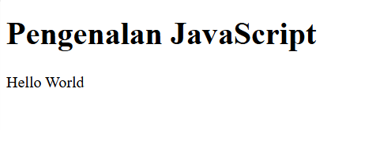

## 2. Alert dan prompt

### Kode CSS

```css
const namaPengguna = prompt("Masukkan nama Anda:", "");
if (namaPengguna && namaPengguna.trim() !== "") {
alert("Halo, " + namaPengguna + "!");
document.getElementById("pesan").textContent = "Selamat datang, " + namaPengguna + ".";
} else {
alert("Nama belum diisi.");
}
```
**Uji dengan memasukkan nama, menekan Cancel, dan membiarkan input kosong. Catat perilaku
program.**

**Screenshot Hasil:**

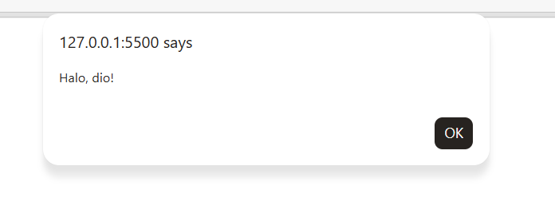

## 3. Function dan operasi aritmetika

**Buat function yang menerima dua bilangan, lalu menampilkan hasil penjumlahan, pengurangan,
perkalian, pembagian, dan sisa bagi.**

### Kode JS

```JS
function operasiDasar(a, b) {
console.log("Penjumlahan:", a + b);
console.log("Pengurangan:", a - b);
console.log("Perkalian:", a * b);
console.log("Pembagian:", b !== 0 ? a / b : "Tidak dapat dibagi nol");
console.log("Modulus:", a % b);
}
operasiDasar(9, 4);
```

**Screenshot Hasil:**

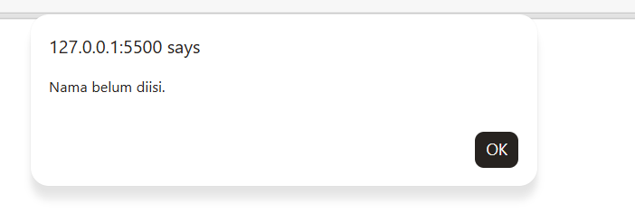


## 4. Seleksi kondisi if–else

**Buat program yang meminta nilai melalui prompt. Nilai minimal 60 dinyatakan lulus. Perhatikan
bahwa prompt menghasilkan string sehingga masukan numerik perlu dikonversi.**

### Kode JS

```JS
const inputNilai = prompt("Masukkan nilai (0–100):");
const nilaiMahasiswa = Number(inputNilai);
if (inputNilai === null || inputNilai.trim() === "" ||
Number.isNaN(nilaiMahasiswa) || nilaiMahasiswa < 0 || nilaiMahasiswa > 100) {
alert("Input nilai tidak valid.");
} else if (nilaiMahasiswa >= 60) {
alert("Lulus");
} else {
alert("Belum lulus");
}
```

**Screenshot Hasil:**

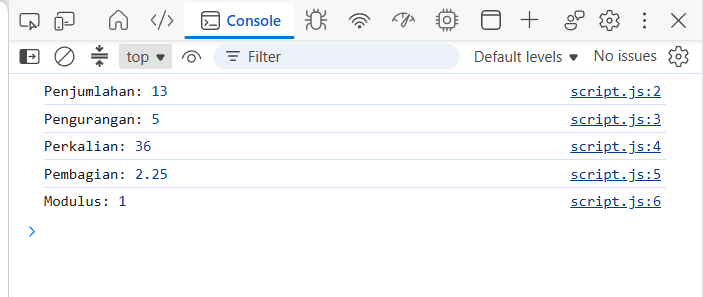

## 5. Seleksi kondisi switch
**Minta pengguna memasukkan angka 1–5 dan tampilkan nama bilangan menggunakan switch.**

### JS

```JS
const inputPilihan = prompt("Masukkan angka 1–5:");
switch (inputPilihan) {
case "1": alert("Bilangan satu"); break;
case "2": alert("Bilangan dua"); break;
case "3": alert("Bilangan tiga"); break;
case "4": alert("Bilangan empat"); break;
case "5": alert("Bilangan lima"); break;
default: alert("Pilihan tidak tersedia");
}
```

**Screenshot Hasil:**

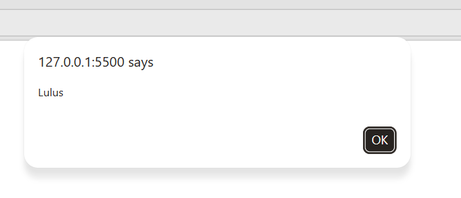

## 6.Form bilangan genap atau ganjil
**Tambahkan form berikut pada body index.html. Saat tombol ditekan, program memeriksa
bilangan dan menampilkan apakah bilangan genap atau ganjil.**

### Kode HTML
```HTML
<label for="bilangan">Masukkan bilangan bulat:</label>
<input type="number" id="bilangan" step="1">
<button type="button" onclick="cekBilangan()">Periksa</button>
<p id="hasilBilangan"></p>

```

### Kode JS

```JS
function cekBilangan() {
const input = document.getElementById("bilangan").value;
const angka = Number(input);
const hasil = document.getElementById("hasilBilangan");
if (input.trim() === "" || !Number.isInteger(angka)) {
hasil.textContent = "Masukkan bilangan bulat yang valid.";
} else if (angka % 2 === 0) {
hasil.textContent = "Bilangan genap";
} else {
hasil.textContent = "Bilangan ganjil";
}
}
```
**Uji dengan angka positif, angka negatif, nol, bilangan desimal, dan input kosong.**

**Screenshot Hasil:**

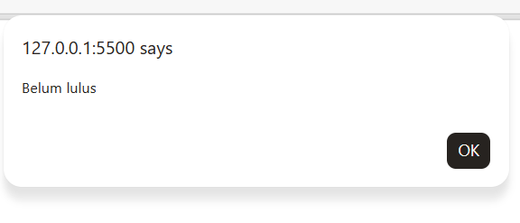


## 7. Mengubah Warna Halaman
**Buat tiga tombol yang mengubah warna latar halaman. Gunakan satu function dengan
parameter agar kode tidak berulang.**

```JS
function ubahWarnaLatar(warna) {
document.body.style.backgroundColor = warna;
}
<button type="button" onclick="ubahWarnaLatar('lightgreen')">Latar Hijau</button>
<button type="button" onclick="ubahWarnaLatar('white')">Latar Putih</button>
<button type="button" onclick="ubahWarnaLatar('lightyellow')">Latar Kuning</button>
```

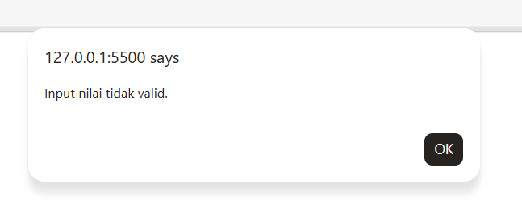

## 8. DOM dan checkbox menu makanan
**Buat daftar menu menggunakan checkbox. Total harga berubah otomatis ketika pilihan
dicentang atau dilepas.**

```JS
const daftarMenu = document.querySelectorAll(".menu");
daftarMenu.forEach((item) => {
item.addEventListener("change", hitungTotal);
});
function hitungTotal() {
let total = 0;
daftarMenu.forEach((item) => {
if (item.checked) total += Number(item.value);
});
document.getElementById("total").textContent = total.toLocaleString("id-ID");
}
```

```HTML
<h3>Daftar Menu Makanan</h3>
<label><input type="checkbox" class="menu" value="5000"> Ayam Goreng — Rp5.000</label><br>
<label><input type="checkbox" class="menu" value="500"> Tempe — Rp500</label><br>
<label><input type="checkbox" class="menu" value="2500"> Telur Dadar — Rp2.500</label><br>
<p>Total: Rp<span id="total">0</span></p>
```

**Catatan: contoh ini menggunakan event listener dan manipulasi DOM. Pastikan elemen HTML
telah tersedia sebelum script dijalankan; meletakkan `<script src="script.js"></script>` menjelang
akhir body merupakan pilihan sederhana.**

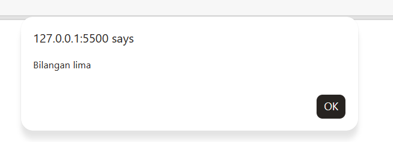

## F. Mini Project — Kalkulator Nilai Mahasiswa
**Kembangkan program yang menerima nilai tugas, UTS, dan UAS, menghitung nilai akhir,
menentukan predikat, serta menampilkan status kelulusan.**

```JS
function hitungNilaiAkhir(tugas, uts, uas) {
return tugas * 0.30 + uts * 0.30 + uas * 0.40;
}
function tentukanPredikat(nilai) {
if (nilai >= 85) return "A";
if (nilai >= 75) return "B";
if (nilai >= 60) return "C";
if (nilai >= 50) return "D";
return "E";
}
const tugas = 85;
const uts = 78;
const uas = 88;
const akhir = hitungNilaiAkhir(tugas, uts, uas);
console.log("Nilai akhir:", akhir.toFixed(2));
console.log("Predikat:", tentukanPredikat(akhir));
console.log("Status:", akhir >= 60 ? "Lulus" : "Belum lulus");
```

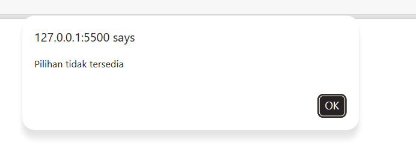

**• Tambahkan form input untuk ketiga komponen nilai.**
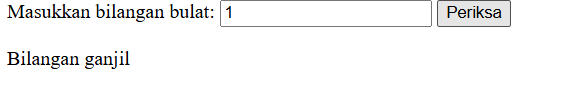

**• Validasi agar setiap nilai berada pada rentang 0–100.**
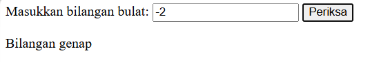

**• Tampilkan nilai akhir, predikat, dan status pada halaman HTML, bukan hanya Console.**
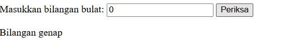

**• Gunakan function untuk memisahkan proses perhitungan dari tampilan hasil.**
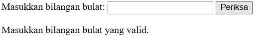

**Uji sekurang-kurangnya tiga skenario nilai berbeda.**
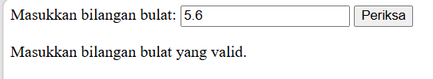

## G. Eksperimen Mandiri

**1. Ubah Latihan 3 agar menerima dua nilai dari prompt dan mengonversinya menjadi number.**
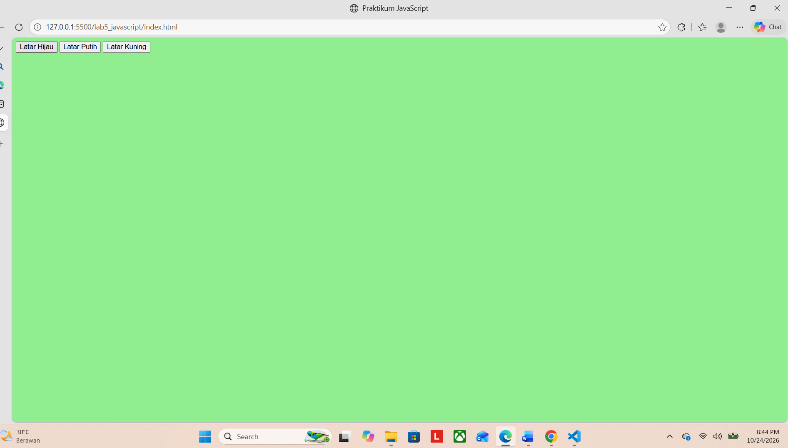

**7. Buat perulangan untuk menampilkan tabel perkalian angka 7 dari 1 sampai 10.**
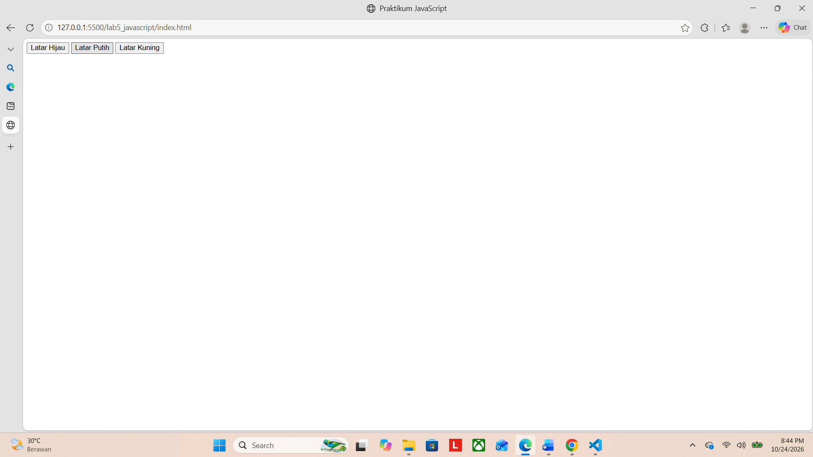

**8. Buat function cekGenap(angka) yang mengembalikan true jika angka genap.**
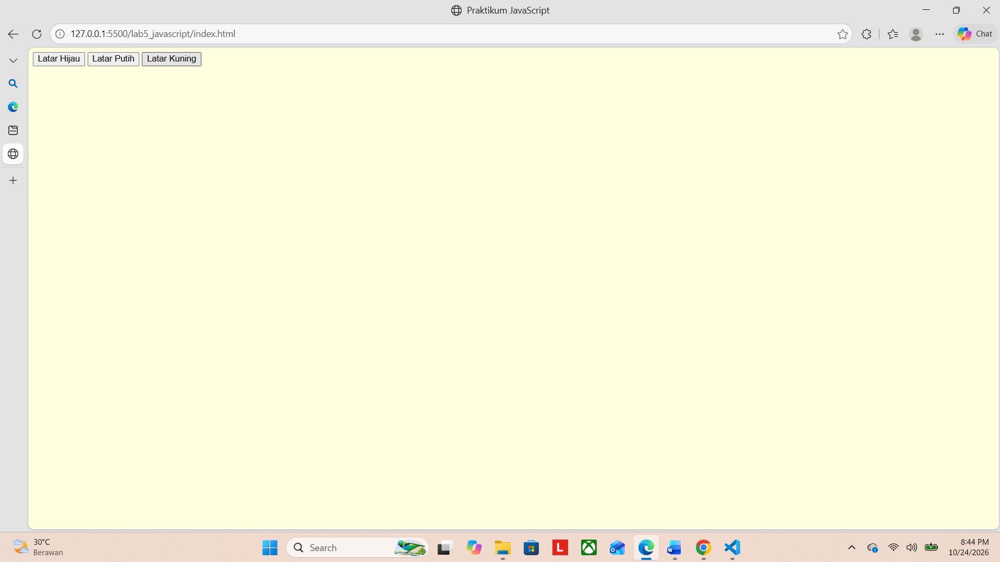

**9. Tambahkan validasi form agar kolom tidak boleh kosong.**
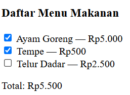

**10. Ubah Latihan 8 dengan menambah minimal dua pilihan menu dan harga.**
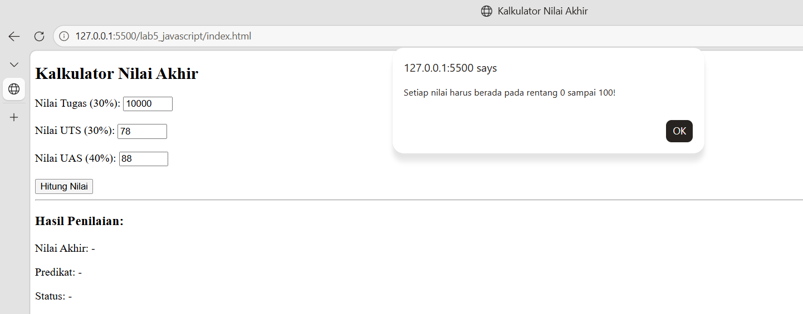

**11. Gunakan tombol untuk menyembunyikan atau menampilkan elemen HTML.**
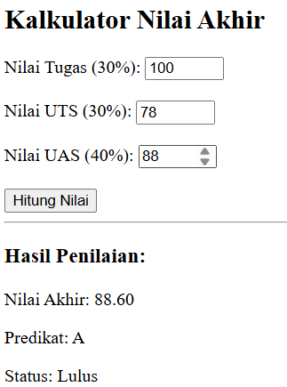
## Checklist Sebelum Dikumpulkan

- [x] Latihan Box Element dan Float berhasil dibuat (`lab4_box.html`).
- [x] Eksperimen clearfix (`clear: left`) berhasil memisahkan baris elemen float.
- [x] Kerangka Semantic HTML5 (`header`, `nav`, `section`, `article`, `aside`, `footer`) diimplementasikan secara terstruktur.
- [x] Layout web sederhana dua kolom (Main Content 640px dan Sidebar 260px) berfungsi dengan proporsional.
- [x] Tiga kotak kolom gambar lingkaran (`.image-circle`) dan featurette artikel bergambar (`float: left` & `float: right`) berhasil ditampilkan.
- [x] Tugas 1 (Single layout menu About `about.html`) telah selesai dibuat dengan profil dan portofolio.
- [x] Tugas 2 (Layout menu Contact `kontak.html`) telah selesai dibuat dengan formulir dan widget kontak.
- [x] Folder `screenshots/` memuat 9 tangkapan layar lengkap (`1.png` - `9.png`).
- [x] Folder `Laporan/` diabaikan oleh Git melalui `.gitignore`.
- [x] Berkas `README.md` disusun rapi dan mendalam sesuai modul.
- [x] Perubahan di-commit secara lokal di repositori dan siap di-push manual oleh mahasiswa.
